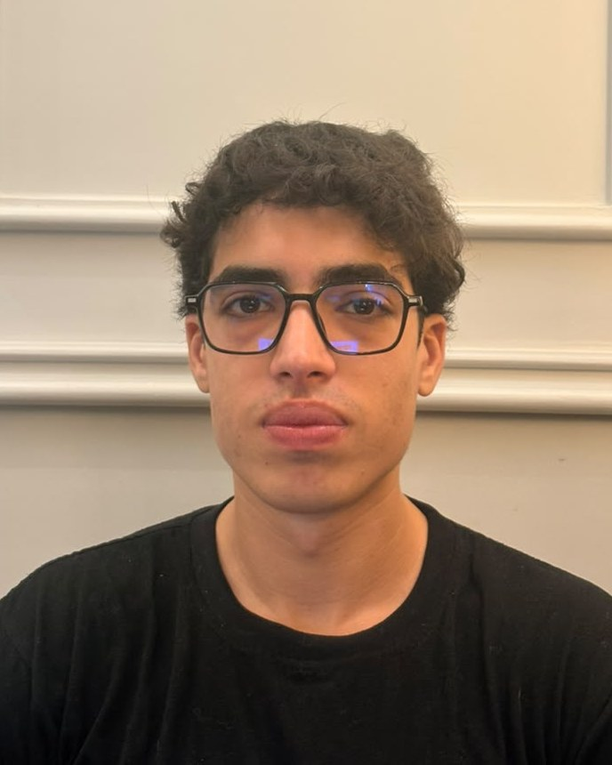

# ABDELHAK ISSAM

**Full-Stack Web Developer · Technicien Spécialisé (OFPPT)**

📍 Salé, Morocco

📧 **[issam.abdelhak19@gmail.com](mailto:issam.abdelhak19@gmail.com)** &nbsp;·&nbsp; 📞 **[+212 6 31 08 41 34](tel:+212631084134)**

---

## 👋 About me

I'm a full-stack web developer in training at **OFPPT in Salé**, where I'm studying to become a
**Technicien Spécialisé in full-stack development**. I build web apps from the database to the
interface with PHP, Laravel, JavaScript and React.

Before moving into development, I spent **two years studying English at Mohammed First University
in Oujda**. That background shapes how I work: I write clear documentation, explain technical ideas
simply, and work comfortably with teams in English and French.

I like building practical things: platforms that connect people, interfaces that match the design
exactly, and small tools that solve a real problem.

---

## 🛠️ Skills

- **Languages:** JavaScript · PHP · Python · HTML · CSS · MySQL
- **Frameworks & Libraries:** React · Laravel · Bootstrap
- **Tools:** Git · GitHub · GitLab (CI / Pages) · Photoshop

---

## 🌍 Languages

| Language | Level |
|---|---|
| 🇲🇦 Arabic | Native |
| 🇬🇧 English | Fluent (2 years of university English studies) |
| 🇫🇷 French | Fluent |
| 🇪🇸 Spanish | Learning |

---

## 🎓 Education

**Technicien Spécialisé, Full-Stack Development** — *In progress* 
OFPPT, Salé 
Full-stack web development: JavaScript, React, PHP, Laravel, MySQL, Git and deployment.

**English Studies** — *2 years* 
Mohammed First University (Université Mohammed Premier), Oujda 
English language and literature, which built my communication and writing skills.

---

## 🚀 Projects

### [Khedma](https://github.com/Likeyoudont/Khedma)
A platform that connects clients with workers. Clients describe the job they need done and find a
worker who can do it.

`PHP` `Laravel` `Blade` `JavaScript`

### [Perfect Pixel](https://github.com/Likeyoudont/Driss-Challenge)
A pixel-perfect rebuild of a design mockup. I measured every size and spacing in Photoshop so the
page matches the design exactly.

`HTML` `CSS` `Photoshop`

### QR Code Generator
A web app that turns any text or link into a QR code you can download and share.

`JavaScript` `HTML` `CSS`

---

### 📬 Let's work together

I'm open to internships, collaborations and freelance work.

📧 **[issam.abdelhak19@gmail.com](mailto:issam.abdelhak19@gmail.com)** &nbsp;·&nbsp; 📞 **[+212 6 31 08 41 34](tel:+212631084134)**

This repository is the source code of my portfolio website, built with React, Vite and plain CSS.

